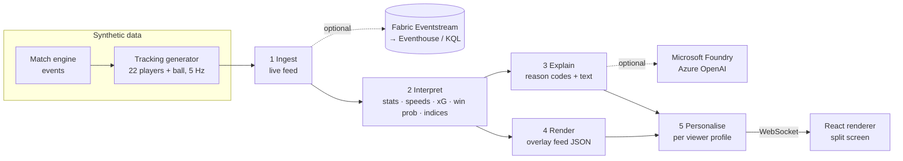

# FootieManager: Inside the Game

Our entry for the Microsoft × Premier League **Inside the Game** hackathon.

FootieManager simulates a football match, works out what's happening as it happens, explains *why* the moments matter, and shows each viewer the match their own way. The same live intelligence reaches a data-hungry analyst and a casual fan as two different experiences, side by side, in several languages.

**Live demo:** https://footiemanager.lemonisland-55346052.eastus2.azurecontainerapps.io/ (Azure Container Apps, running Microsoft Foundry and Fabric).

Everything runs locally with no cloud setup. Microsoft Foundry (AI narration and Q&A) and Microsoft Fabric (live event store) switch on when you add credentials.

---

## Quick start

You need **Python 3.11+** and **Node 20+**.

```powershell
# 1. Backend (terminal 1)
cd backend
python -m venv .venv
.venv\Scripts\activate            # macOS/Linux: source .venv/bin/activate
pip install -r requirements.txt
uvicorn server:app --reload --port 8000

# 2. Front end (terminal 2)
cd frontend
npm install
npm run dev                        # open http://localhost:5173
```

The first start simulates the three demo matches and caches them in `backend/.cache/` (about 10 seconds). After that, startup is instant.

**One-process mode:** run `npm run build` in `frontend/`, then only the backend. It serves the built app at http://localhost:8000.

**Docker:** `docker compose up --build`, then http://localhost:8000. This is the same container we'd deploy to Azure Container Apps or AKS, reading settings from `backend/.env`.

**Tests:** `cd backend && python -m pytest -q` (29 tests: data realism, every pipeline stage, all four languages, personalisation, LLM layer, the Verifier and the agent's tool loop with stubs).

### Using the app

- **Match** picker (top left): three scripted stories, *The Comeback*, *Ten Men* and *Late Drama*.
- **Play / Pause, Speed** (1×–60×) and the **timeline** to jump anywhere.
- **Split screen**: Viewer A and Viewer B each have their own **mode**, **language**, **favourite club** and (in Player focus) **player**.
- **Replay** on any key moment in the feed jumps back 8 seconds and replays it at 2×.
- **Ask the match**: free-text questions about the live game.
- **Deep links** for demos, which open straight at a moment:
  `http://localhost:5173/?scenario=comeback&t=4110&speed=3` (just before the 67' winner)
  `?scenario=red_card&t=3540` (red card) · `?split=0` (single view)

---

## How it answers the brief

The brief asks for *one pipeline with five stages*. Each stage is one module:

| Stage | Module | What it does |
|---|---|---|
| **1. Ingest** | [backend/footie/pipeline/ingest.py](backend/footie/pipeline/ingest.py) | Replays the match as a live feed (events + 5 Hz tracking) against a moving clock. Optionally forwards every event to a **Fabric Eventstream**. |
| **2. Interpret** | [backend/footie/pipeline/interpret.py](backend/footie/pipeline/interpret.py) | Incremental analytics: team and player stats, pass distance/accuracy/difficulty, ball and shot speed, player speed/distance/sprints, xG, live win probability, three story indices, key-moment detection. |
| **3. Explain** | [backend/footie/pipeline/explain.py](backend/footie/pipeline/explain.py) | Turns facts into auditable *reason codes* ("came against the run of play", "started with a high regain 17 seconds earlier"), then into text: multilingual templates always, **Foundry** LLM rewrite when configured. |
| **4. Render** | [backend/footie/pipeline/render.py](backend/footie/pipeline/render.py) | A timed, machine-readable **overlay feed** (JSON) that any graphics engine can draw in sync with the match. See [docs/overlay-contract.md](docs/overlay-contract.md). Our React app is one renderer. |
| **5. Personalise** | [backend/footie/pipeline/personalize.py](backend/footie/pipeline/personalize.py) | A viewer profile (mode, language, club, player, metric) decides which overlays appear, how urgent they are and how they're worded. |

Other things the brief lists:

| Brief item | Where |
|---|---|
| Player tags with speed/distance thresholds | `top_speed` (new match record ≥ 30 km/h), `sprint` (≥ 1 s above 25.2 km/h), `distance` (every km) → `player_tag` overlays anchored to the player |
| Pass quality | distance, ball speed, a 0–100 difficulty rating, completion %, under-pressure flag (`pass_card`) |
| Speed metrics | ball speed per pass, shot speed per shot (`shot_card`), player top speed |
| Narratives, milestones, recaps | live commentary ticker, braces/hat-tricks, half-time and full-time recaps with turning point and standout player. **Milestones** against each player's season and career record (synthetic, [backend/footie/sim/history.py](backend/footie/sim/history.py)): 50 goals for the club, 100 career goals, double figures for the season, a first goal of the season or for the club, a debut, a 200th appearance; called out on a `milestone` card and in the goal's "why it mattered" |
| Explainability: control vs chaos, pressure, rhythm | three 0–100 indices, alerts when they shift, every claim backed by numbers |
| Agentic AI | **Ask the match** is a tool-using agent on Microsoft Foundry: it chooses among six read-only tools over the live match (state, player stats, rankings, key moments, trends, raw event counts), shows each step it took, and only cites moments it actually looked up ([backend/footie/pipeline/agent.py](backend/footie/pipeline/agent.py)) |
| Multi-agent fact-checking | A **Narrator agent** writes each key moment and a **Verifier agent** checks it before it airs: software checks every number against the computed facts, then an AI fact-check covers players, teams, score and fan framing. Failures go back to the Narrator once, else the template stays. Evaluated over 206 narrations in 4 languages: [docs/evaluation.md](docs/evaluation.md) |
| Grounded, auditable AI | **Sources** on every key moment shows the exact facts, reasons and match events the explanation (or the AI) was given; AI answers cite the moments they used |
| Data innovation | our own match engine + tracking generator, dataset in [data/](data/), `python cli.py generate` for unlimited new matches |
| Multi-language | English, Spanish, French, Swahili via templates (offline); Portuguese, Arabic and Hindi too when Foundry is on |
| Personal modes | Analyst · Casual fan · Player focus · Single metric, plus favourite-club framing. **Player Cam** (in Player focus): the pitch follows the player with their trail, live speed, vision cone, the gap to the nearest opponent, and every pass option scored by difficulty |
| Auto-eventing from video | Computer vision over a rendered, degraded video feed finds passes and shots and measures their distance and speed, scored against the synthetic ground truth: 99% of passes and 4 of 5 shots found, 96% precision, pass distance within 1.2 m, ball speed within 2.3 km/h ([docs/auto-eventing.md](docs/auto-eventing.md), `python cli.py autoevent`). Not tested on real footage |

---

## Architecture



Stages 1, 2 and 4 run once per match. Stages 3 and 5 run per viewer, which is how one connection drives two different viewers.

```
backend/
  server.py                 FastAPI: REST + WebSocket stream (/ws/match/{scenario})
  cli.py                    export dataset, generate matches, print narration reports
  footie/
    football_models.py      xG, pass difficulty, win probability (closed-form, explainable)
    i18n.py                 phrasebook: en / es / fr / sw
    llm.py                  Foundry (Azure OpenAI) client, optional
    sim/                    teams.py, simulator.py (events), tracking.py (positions), scenarios.py
    pipeline/               ingest, interpret, explain, render, personalize, runner
  tests/
frontend/
  src/App.tsx               shell: match picker, playback, split screen
  src/useMatchStream.ts     WebSocket client
  src/components/           Pitch (canvas), Stage (overlays), Panels, Viewer
data/                       exported dataset: metadata, events, insights, overlays per scenario
docs/                       overlay contract, Fabric setup, demo script
```

### The synthetic data

All clubs and players are fictional. The engine walks the match as a chain of on-ball actions. Each choice depends on pitch zone, player attributes and team style, plus a per-scenario script of multipliers so the demo stories happen on cue. The tracking generator then moves 22 players and the ball with real top-speed and acceleration limits. That makes the speeds and distances physically plausible, not invented.

What a typical match looks like (checked by the tests): about 1,300 passes at about 80% completion, about 30 shots, 2–4 goals, outfield players covering 7–14 km with top speeds of 30–34 km/h.

### The story indices (0–100, 5-minute window, smoothed)

- **Control vs chaos**: passes per possession, pass completion, turnovers per minute. Low means the ball keeps changing hands.
- **Pressure** (per team): pressures per minute, plus ball wins in the opposition half.
- **Rhythm**: on-ball events per minute, minus time lost to stoppages.
- **Momentum** (10 minutes): xG difference, final-third entries and possession share.

Win probability is a Poisson model on the score, minutes left and each team's scoring rate. The rate blends pre-match strength with live xG and momentum, and adjusts for red cards.

---

## Switching on the Microsoft stack

Copy `backend/.env.example` to `backend/.env` and fill in what you have. Restart the backend; the **Foundry** and **Fabric** badges in the app turn green.

### Microsoft Foundry (AI narration, any language, Ask the match)

1. In [Azure AI Foundry](https://ai.azure.com), create a project and deploy a chat model (for example `gpt-4o-mini`).
2. Copy the Azure OpenAI endpoint, key and deployment name into `.env`:
   `AZURE_OPENAI_ENDPOINT`, `AZURE_OPENAI_API_KEY`, `AZURE_OPENAI_DEPLOYMENT`.

**No Azure subscription?** Any OpenAI-compatible API also works: set `OPENAI_API_KEY`, `OPENAI_MODEL` and, for providers other than OpenAI, `OPENAI_BASE_URL`. If both are set, Foundry wins. We use **Groq's free tier** for now (`OPENAI_BASE_URL=https://api.groq.com/openai/v1`, `OPENAI_MODEL=openai/gpt-oss-120b`; key from console.groq.com). Its limit is 8,000 tokens per minute, so at high playback speeds some moments keep their template text. (GitHub Models was retired in July 2026 and is not an option.)

What changes: key moments, alerts and recaps first appear with template text, then upgrade to model-written text a moment later (marked **AI**). The model is given only the computed facts and reason codes, and is told not to invent anything. "Ask the match" answers from the live match state and cites moment ids. Template text remains the fallback if the model is slow or fails.

### Microsoft Fabric (live event store)

See [docs/fabric.md](docs/fabric.md). In short: create an Eventstream with a custom endpoint source, put its connection string in `FABRIC_EVENTSTREAM_CONNECTION_STRING`, run `pip install azure-eventhub`, and route it to an Eventhouse table. Every event is then queryable with KQL while the match plays.

### Deploy to Azure

The repo builds into one container (API + front end):

```bash
az containerapp up --name footiemanager --resource-group rg-footiemanager \
  --location westeurope --source . --ingress external --target-port 8000 \
  --env-vars AZURE_OPENAI_ENDPOINT=... AZURE_OPENAI_API_KEY=... AZURE_OPENAI_DEPLOYMENT=gpt-4o-mini
```

GitHub Actions ([.github/workflows/ci.yml](.github/workflows/ci.yml)) runs the tests and the front-end build on every push.

**Hosting costs (estimate).** The live demo runs on an Azure free account ($200 credit, 30 days from 26 October). Container Apps at 1 vCPU / 2 GB, always on, costs about $2.50 a day in the worst case, so about $40 through the end of judging (10 November). Foundry gpt-4.1-mini costs about $0.10 per full match watched with AI narration. A budget alert at $50 watches actual spend. A free account doesn't charge the card unless it's upgraded; if the credit ran out, Azure would stop the resources rather than bill.

---

## Reviewing the narration (no coding needed)

```powershell
cd backend
python cli.py report --scenario comeback --mode casual --lang es --club RVA
python cli.py report --scenario red_card --mode analyst --lang fr
python cli.py report --scenario derby --mode player --player NBR-9 --all
```

This prints every moment a viewer would see, in order. Use it to check tone and translations. The templates live in [backend/footie/i18n.py](backend/footie/i18n.py), one block per language.

## Data export

```powershell
python cli.py export --scenario all --out ../data             # metadata, events, insights, overlays
python cli.py export --scenario comeback --out ../data --tracking   # + 5 Hz positions (~20 MB)
python cli.py generate --home KSU --away NBR --seed 7 --out ../data # any new fixture
```

---

## Known limitations

- **Foundry and Fabric paths are written but untested against live services.** The LLM layer is tested with a stub; the Fabric sink needs `azure-eventhub` and a real Eventstream. Test both as soon as credentials exist.
- **Seeking** backwards replays the match from kick-off in the background (about 3 seconds for a late jump).
- **Story seeds are pinned** in `sim/scenarios.py`. If you change the engine, bump `CACHE_VERSION` and re-run `find_seed()` for each scenario so the stories still happen.
- Spanish, French and Swahili templates were not written by native speakers and should be checked before the demo.
- No auto-eventing from video. The ends do not swap at half-time (home always attacks right).

## Next steps (in priority order for the deadline)

1. Add Foundry credentials, watch the AI text on a full match, tune `PERSONAS` / `SYSTEM_PROMPT` in `explain.py`.
2. Wire Fabric (Eventstream → Eventhouse) and show a KQL query running during the demo.
3. Deploy with `az containerapp up` and share the URL.
4. Record the demo video: [docs/demo-script.md](docs/demo-script.md).
5. Stretch: render top-down video from tracking, detect the ball and players, and score auto-eventing accuracy against our ground truth.
